# Décompte

**Le compteur de scores universel pour vos jeux de société, sur Android.**

Décrivez une fois la feuille de score d'un jeu (ses catégories, leur mode de calcul, ses manches, ses règles de classement) : à chaque partie, Décompte guide la saisie catégorie par catégorie, fait les additions, désigne le gagnant et garde tout dans un historique avec graphiques et statistiques. Tout reste sur le téléphone, sans compte à créer ni publicité ; une sauvegarde sur Google Drive est proposée en option.

  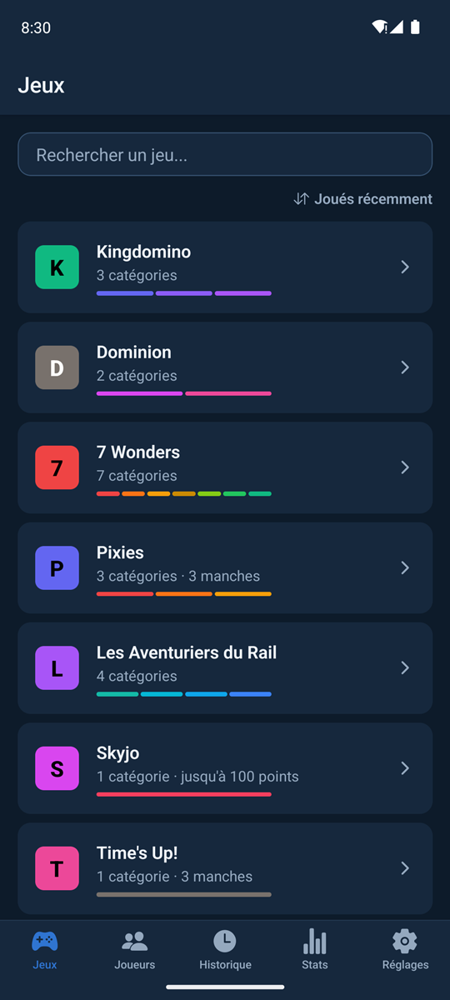
  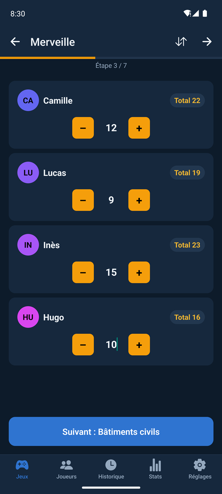
  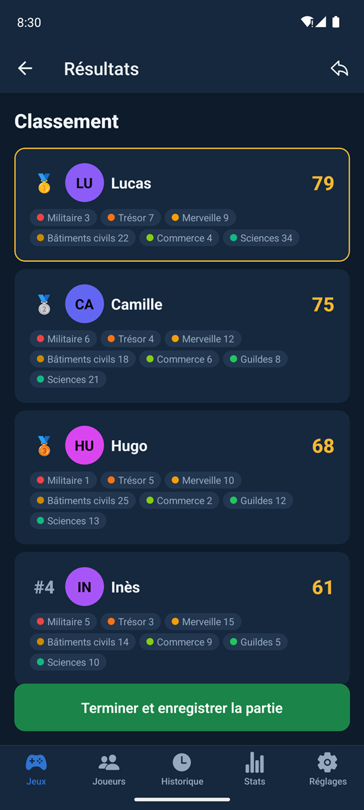

> **Télécharger** : dernière version dans les [Releases GitHub](https://github.com/Forthtilliath/decompte/releases) (fichier `Decompte-<version>.apk`). L'app est en phase alpha : tout fonctionne, mais l'interface peut encore évoluer d'une version à l'autre.

## Sommaire

- [Des feuilles de score sur mesure](#des-feuilles-de-score-sur-mesure)
- [Lancer une partie](#lancer-une-partie)
- [La saisie guidée](#la-saisie-guidée)
- [Résultats et classement](#résultats-et-classement)
- [Historique des parties](#historique-des-parties)
- [Statistiques](#statistiques)
- [Joueurs et groupes](#joueurs-et-groupes)
- [Partager un jeu](#partager-un-jeu)
- [Apparence](#apparence)
- [Sauvegarde, mises à jour et widget](#sauvegarde-mises-à-jour-et-widget)
- [Accessibilité](#accessibilité)
- [Vos données](#vos-données)
- [Installation](#installation)

## Des feuilles de score sur mesure

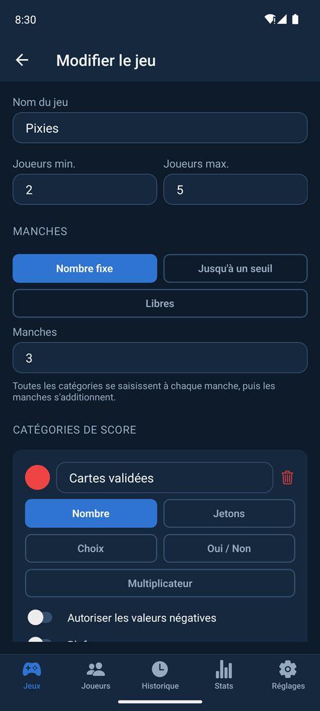

Chaque jeu se compose d'une ou plusieurs **catégories de score**, chacune avec son nom, sa couleur (18 teintes au choix) et son mode de calcul :

- **Nombre** : des points saisis à la main, avec négatifs et plafond en option. Une **valeur par unité** est possible (ex. 5 points par objectif, −4 par calamité) : on saisit alors soit le nombre d'unités, soit les points directement.
- **Jetons** : des jetons de valeurs différentes à compter (ex. Domaine 1, Duché 3, Province 6, Malédiction −1), additionnés automatiquement.
- **Choix** : une option parmi plusieurs, chacune à score fixe (ex. palier militaire atteint).
- **Oui / Non** : une condition remplie ou non, chaque réponse avec son propre score (ex. +10 pour le plus long chemin).
- **Multiplicateur** : un nombre saisi multiplié par les points d'une catégorie précédente (ex. nombre de sets × valeur des sets).

Une catégorie peut aussi exiger un **critère à valider** : chaque joueur a une case à cocher, et ses points ne comptent qu'une fois le critère rempli.

**Manches** : en une seule fois, en un **nombre fixe** de manches (toutes les catégories se rejouent à chaque manche, puis les manches s'additionnent), **jusqu'à un seuil** de points (ex. fin dès qu'un joueur atteint 100 points), ou **libres** (on arrête quand on veut).

**Règles de classement** : le plus haut total gagne, ou **le plus bas** (golf, Skyjo…) ; une catégorie peut **départager les égalités** (ex. le trésor à 7 Wonders) ; un jeu peut se jouer **en équipes**, classées sur la somme de leurs joueurs.

**20 modèles prêts à l'emploi**, ajoutés en un geste puis modifiables :

| Incontournables | Jeux familiaux | Jeux experts |
|---|---|---|
| 7 Wonders, Les Aventuriers du Rail, Kingdomino, Time's Up!, Golf (jeu de cartes), Odin, Skyjo, 6 qui prend ! | Catane, Citadelles, Akropolis, Harmonies, Faraway, Small World of Warcraft | Terraforming Mars, 7 Wonders Duel, Five Tribes, It's a Wonderful World, Dominion, Alhambra |

  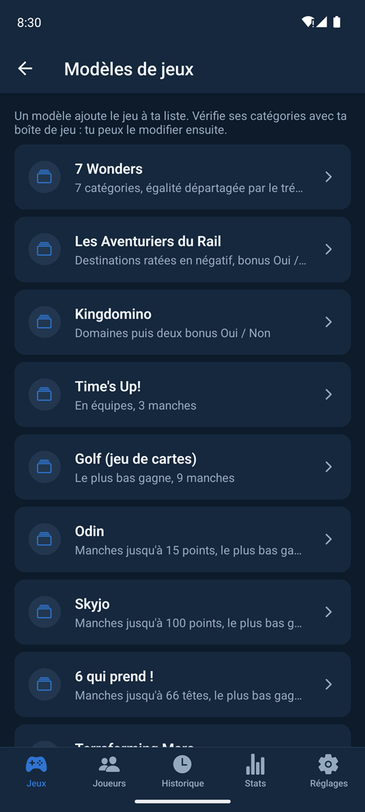

La liste des jeux montre les couleurs des catégories et le déroulé de chaque jeu (« 3 manches », « jusqu'à 100 points »). Elle se cherche sans tenir compte des accents et se trie au choix : joués récemment, les plus joués, ordre alphabétique ou ajoutés récemment.

 

## Lancer une partie

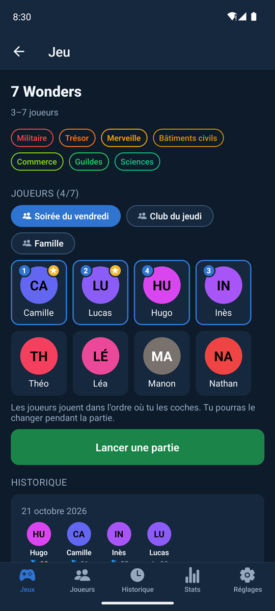

La fiche d'un jeu présente ses catégories, puis le choix des joueurs :

- un **groupe** d'habitués (« Soirée du vendredi ») se coche d'un geste ;
- les **favoris** sont proposés en premier, puis les joueurs les plus fréquents ;
- les joueurs **jouent dans l'ordre où on les coche** (numéro affiché sur leur avatar), modifiable à tout moment pendant la saisie ;
- pour un jeu en équipes, chaque joueur rejoint une équipe au lancement.

En dessous, les **5 dernières parties** de ce jeu ; les autres sont dans l'historique, déjà filtré sur ce jeu.

Depuis la fiche, on peut aussi **modifier** le jeu, le **partager** (texte ou QR code), l'**archiver** ou le **supprimer** (seulement s'il n'a encore aucune partie dans l'historique : sinon, l'archivage est proposé).

 

## La saisie guidée

Une catégorie à la fois, dans la couleur de la catégorie, avec la progression en haut (« Étape 3 / 7 ») et le **total de chaque joueur** mis à jour en continu.

- Boutons − / + ou saisie directe au clavier ; la touche Entrée passe au joueur suivant, puis à l'étape suivante.
- On avance par un **balayage** ou par le bouton du bas, qui annonce la catégorie suivante.
- L'**ordre des joueurs** se change depuis la saisie (icône ⇅).
- L'**écran reste allumé** pendant toute la partie.
- Pour les jeux à **manches ouvertes**, un récapitulatif s'affiche à la fin de chaque manche : totaux cumulés, écart au seuil, puis manche suivante ou fin de la partie. Le seuil atteint termine la partie.
- La **partie en cours est sauvegardée** : on la reprend plus tard à l'étape où on l'avait laissée, ou on l'abandonne.

 

## Résultats et classement

Le **classement final** s'affiche avec médailles, le total de chaque joueur (ou de chaque équipe) et le détail de ses points catégorie par catégorie. Les ex æquo sont gérés, et le départage éventuel appliqué.

Avant l'enregistrement, les catégories **laissées vides** pour un joueur sont signalées, avec un lien pour les compléter.

Pour les jeux en plusieurs manches, le **classement après chaque manche** se consulte aussi, ainsi que les graphiques de la partie.

 

## Historique des parties

  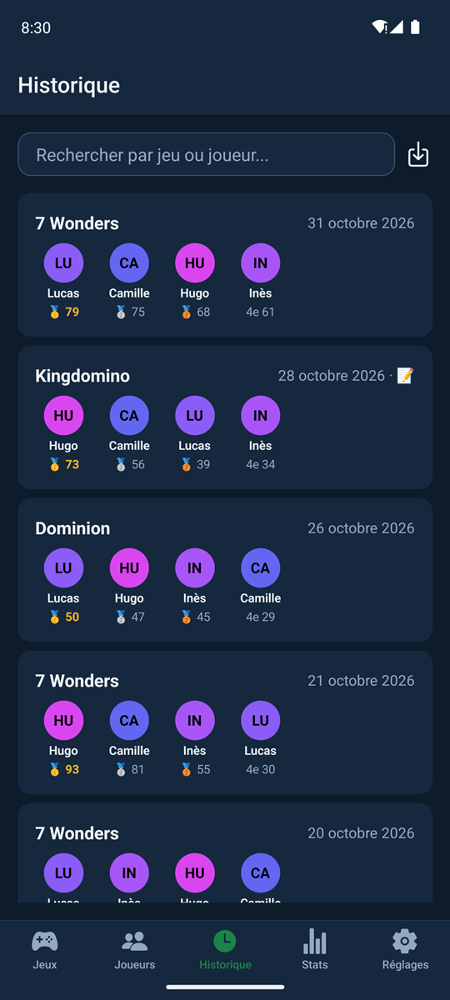
  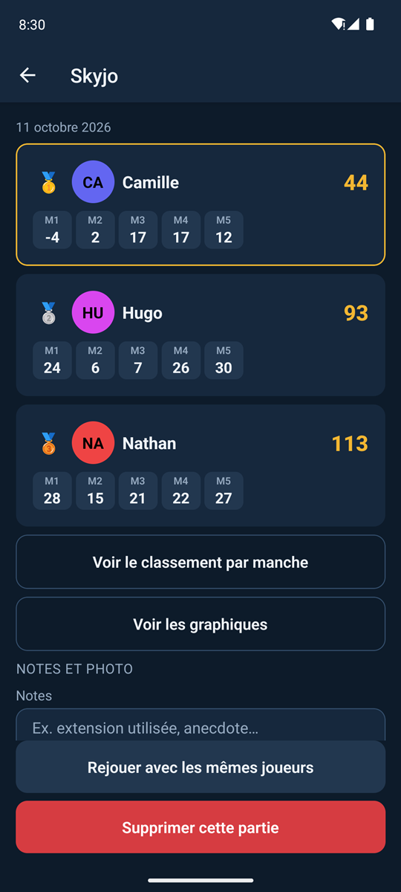
  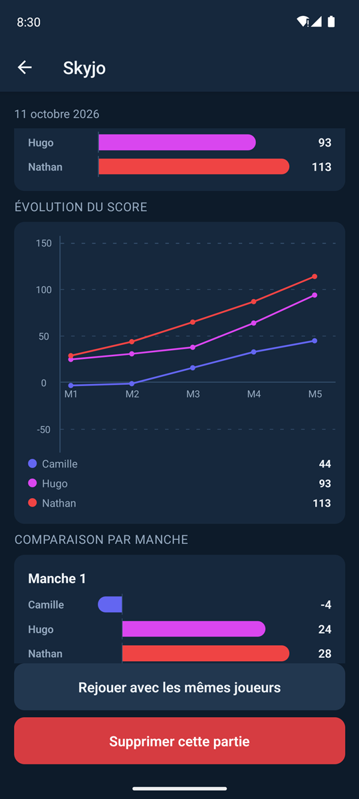

Toutes les parties terminées, avec podium et scores, cherchables par jeu ou par joueur (sans tenir compte des accents) et filtrables par jeu. Le détail d'une partie montre :

- le classement, les points de chaque catégorie et de chaque manche (M1, M2…), et le **classement par manche** ;
- des **graphiques** : répartition des points de chaque joueur, comparaison des joueurs catégorie par catégorie et manche par manche, **évolution du score** au fil des manches ;
- des **notes** et une **photo de la table** (gardée dans l'app, sans ses métadonnées) ;
- **Rejouer avec les mêmes joueurs** en un geste, **partager la partie en image** (classement prêt à envoyer dans une conversation), ou la **supprimer** (annulable pendant quelques secondes).

L'historique affiché (recherche et filtre compris) s'**exporte en CSV** pour un tableur.

## Statistiques

  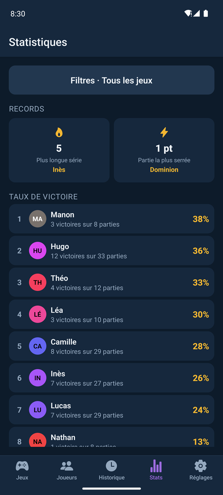
  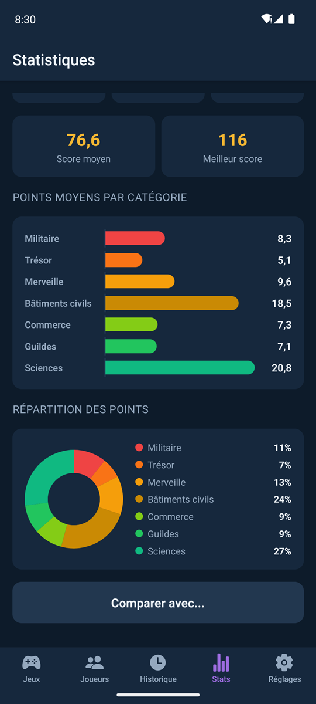

Tous jeux confondus ou pour un jeu en particulier :

- **records** : meilleur score, plus longue série de victoires, partie la plus serrée ;
- **taux de victoire** de chaque joueur ;
- jeux les plus joués ;
- pour un joueur : score moyen, meilleur score, **points moyens par catégorie** et par manche, **répartition de ses points**, en graphique ou en tableau, et **comparaison avec un autre joueur**.

## Joueurs et groupes

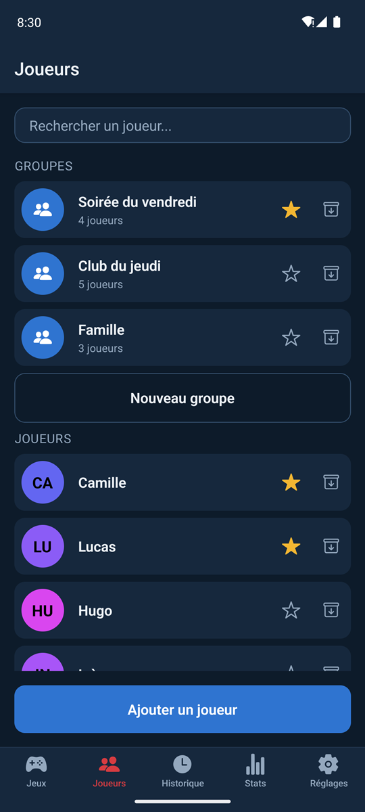

- **Avatar** en photo (prise sur le moment ou choisie dans la galerie, gardée en miniature dans l'app, sans ses métadonnées) ou initiales sur une couleur propre à chaque joueur.
- **Favoris** marqués d'une étoile, proposés en premier au lancement d'une partie.
- **Groupes** d'habitués, pour cocher toute la tablée d'un coup.
- Rien n'est supprimé définitivement par accident : joueurs, groupes et jeux s'**archivent**, pour que l'historique reste lisible. Avant de supprimer un joueur, l'app indique dans combien de parties il apparaît et propose de l'archiver plutôt.

 

## Partager un jeu

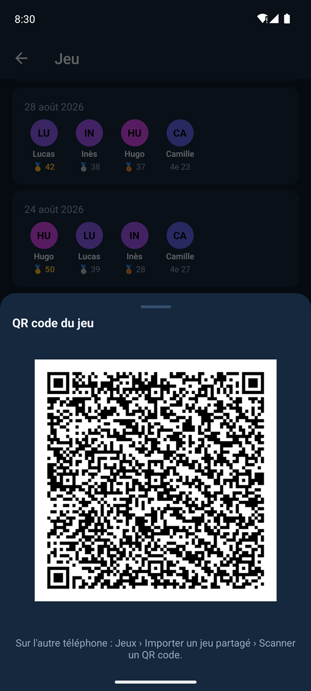

Une feuille de score se transmet à un autre joueur de Décompte, couleurs et règles comprises :

- en **texte**, envoyé par n'importe quelle messagerie puis collé dans Jeux ▸ Importer un jeu partagé ;
- en **QR code**, scanné directement par l'autre téléphone.

Le jeu reçu est **entièrement vérifié** avant d'être ajouté : un texte abîmé ou modifié est refusé avec un message clair, sans rien ajouter.

 

## Apparence

  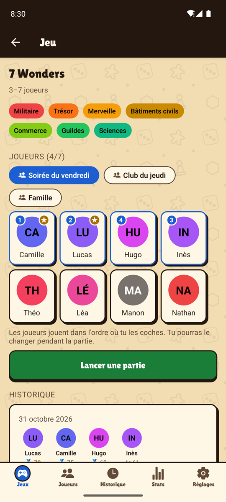
  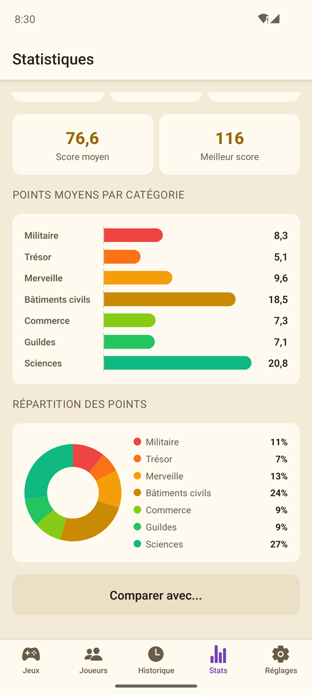
  

Trois thèmes, chacun avec sa couleur de fond au choix :

- **Sombre** : bleu nuit, tapis vert, acajou, ardoise ;
- **Clair** : carton, blanc, sauge, rose poudré ;
- **Ludique** : décor de plateau (dés, pions, meeples), boutons en relief façon jetons, titres en police d'affiche ; fonds plateau, kraft, lagon, bonbon.

## Sauvegarde, mises à jour et widget

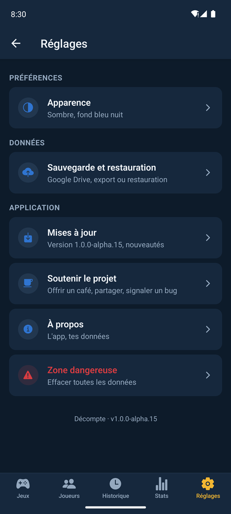

- **Sauvegarde Google Drive** automatique après chaque changement, dans un dossier privé réservé à l'app, avec **chiffrement** en option. Pratique pour changer de téléphone sans rien perdre.
- **Sauvegarde manuelle** : export d'un fichier, restauration, et **annulation de la dernière restauration**. Chaque sauvegarde est entièrement vérifiée avant d'être appliquée.
- **Mises à jour en un geste** : l'app annonce une nouvelle version, la télécharge et lance son installation. L'historique des versions et de leurs nouveautés est dans Réglages ▸ Mises à jour.
- **Widget Android** pour l'écran d'accueil : reprendre la partie en cours, ou voir le vainqueur de la dernière partie.
- **Soutenir le projet** : offrir un café, partager l'app, signaler un bug.
- **Zone dangereuse** : effacer toutes les données, après avoir tapé « EFFACER ».

 

## Accessibilité

- Textes lisibles sur toutes les couleurs de catégorie : le contraste est calculé, le texte passe en blanc ou en noir selon la teinte.
- La taille de police agrandie d'Android est respectée (plafonnée seulement dans les zones étroites).
- Classements, historique, tableaux et graphiques sont lus d'un bloc par le lecteur d'écran (TalkBack).
- Les animations sont coupées si Android le demande.
- Retour haptique sur les actions principales.

## Vos données

- **Aucun compte, aucune publicité, aucun suivi.** Tout est stocké sur le téléphone ; rien ne part ailleurs sauf si vous activez la sauvegarde Google Drive (dossier privé de l'app, invisible dans votre Drive).
- La sauvegarde automatique d'Android est désactivée : seule la sauvegarde de l'app, vérifiée et éventuellement chiffrée, copie vos données hors du téléphone.
- Une app réinstallée et vide n'écrase jamais une sauvegarde Google Drive qui contient des données.
- L'appareil photo n'est demandé qu'au premier usage (avatar, photo de la table, lecture d'un QR code), sans micro. Les photos restent dans le dossier privé de l'app et ne partent dans aucune sauvegarde.
- Les mises à jour ne viennent que des releases officielles de ce projet, en HTTPS, avec vérification de l'empreinte du fichier avant installation ; Android demande toujours votre confirmation.
- L'export CSV neutralise les formules qu'un nom ou une note pourrait cacher.

## Installation

1. Sur le téléphone Android, ouvrez la [page des Releases](https://github.com/Forthtilliath/decompte/releases) et téléchargez le fichier `Decompte-<version>.apk` de la dernière version.
2. Ouvrez le fichier : Android demande d'autoriser l'installation depuis le navigateur ou le gestionnaire de fichiers, une seule fois.
3. Les versions suivantes s'installent ensuite depuis l'app (Réglages ▸ Mises à jour), sans repasser par GitHub.

L'app est disponible pour Android uniquement.

## Développement

Installation de l'environnement, architecture, tests, configuration de Google Drive et publication d'une version : voir le [README développeurs](docs/README.md).

## Licence

[MIT](LICENSE)
